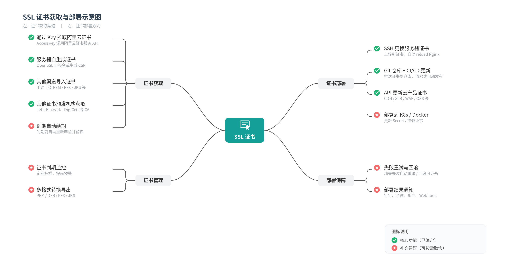
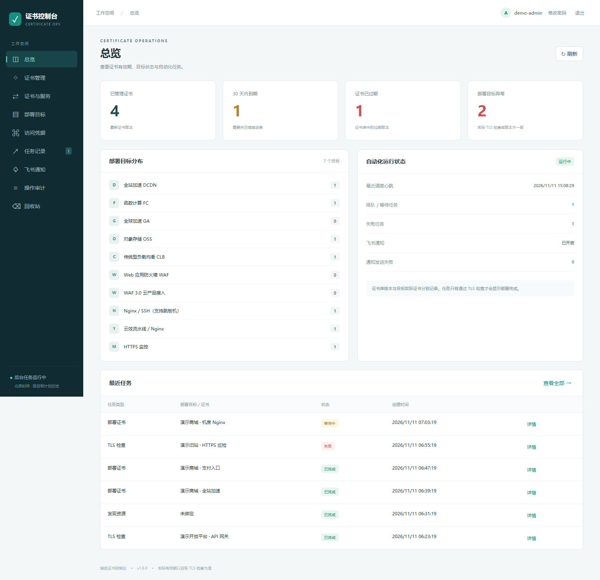
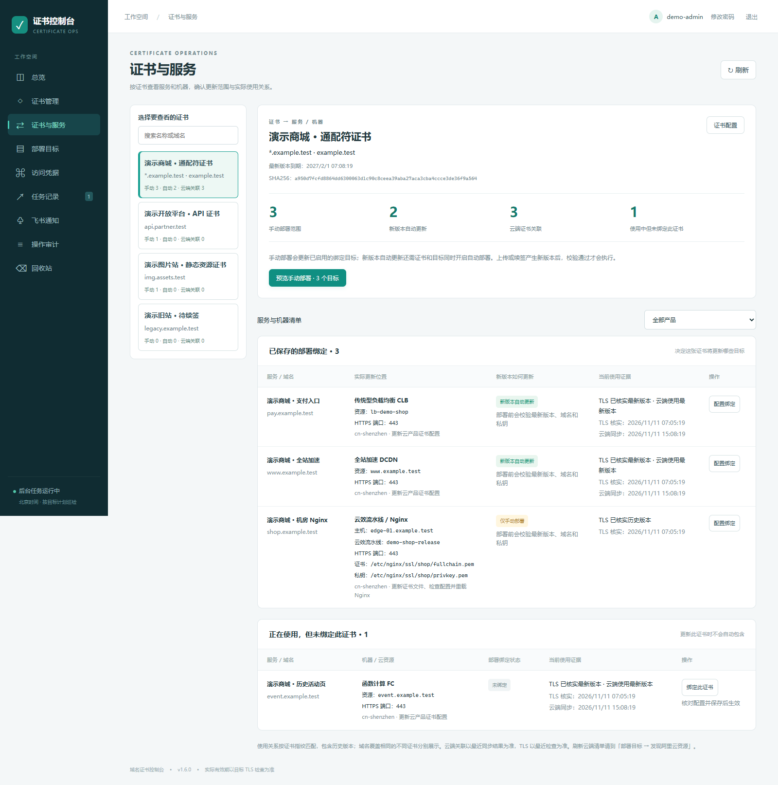
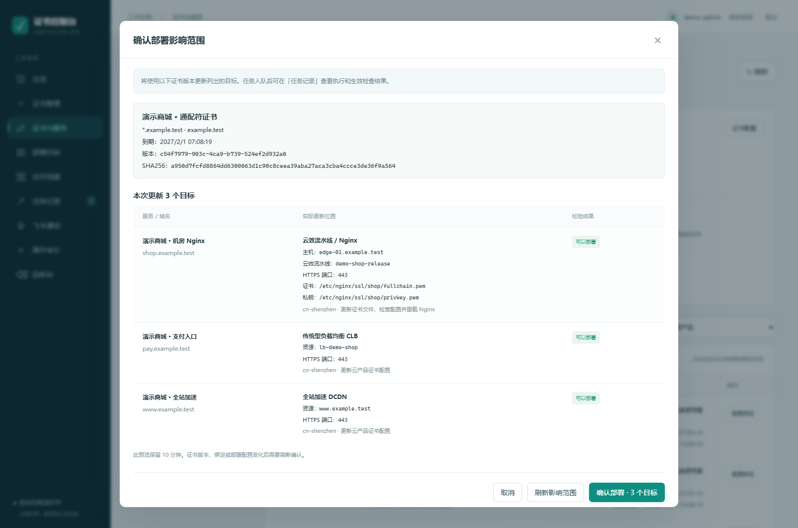
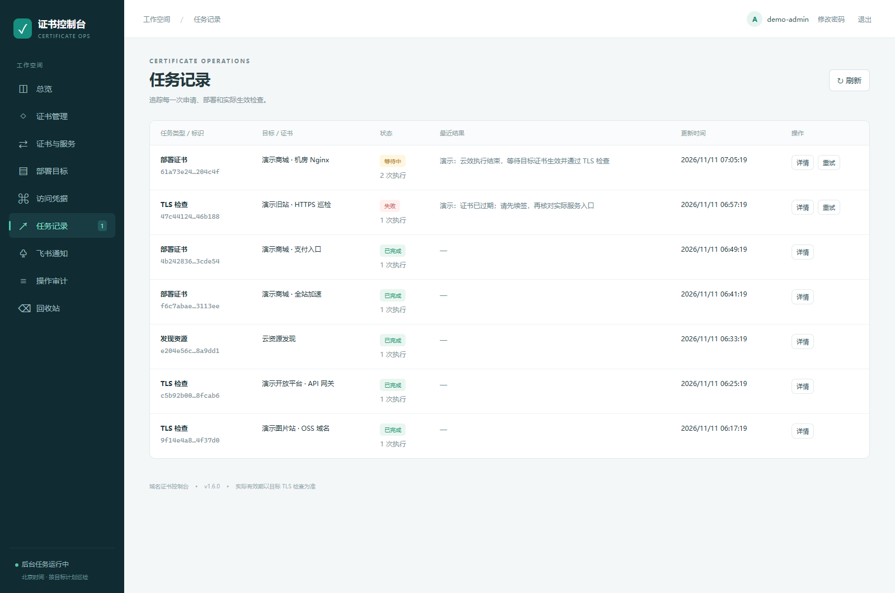

# CertOps — SSL/TLS certificate management and deployment

**[简体中文](README.md) | English**

[GitHub](https://github.com/tanxl0810-cyber/certops) · [Gitee mirror](https://gitee.com/norman-tan/certops) · [First trial guide (Chinese)](docs/TRY_IT.md) · [FAQ (Chinese)](docs/FAQ.md)

[](https://github.com/tanxl0810-cyber/certops/actions/workflows/ci.yml)

**From expiry alerts to deployment and verification at each endpoint.**

CertOps is a self-hosted certificate operations console for trusted teams managing **Alibaba Cloud services and Nginx hosts**. It keeps certificate versions, saved deployment bindings, deployment previews, task progress, and observed TLS certificates in one place.

A renewed certificate may be used by a CDN domain, a load balancer, and an on-premises Nginx server. CertOps helps identify those destinations, review the exact update scope, and check which certificate each endpoint actually serves.

This is an **early public release** under the [Apache-2.0 license](LICENSE). Self-hosting and commercial use are permitted by the license. Optional deployment, customization, and maintenance services are described in [SERVICES](SERVICES.md).

[See the workflow](#a-certificate-update-in-four-steps) · [Quick start](#quick-start) · [First target](#connect-your-first-target) · [Current limits](#current-limits)

The application interface and screenshots are currently in Chinese. This English README covers the workflow, installation, first target, and supported scope; detailed operational guides are in Chinese.

## What it supports

- Upload PEM certificates and private keys; import existing Alibaba Cloud certificates; retain versions and deduplicate by fingerprint.
- Request and renew certificates using existing Alibaba Cloud SSL V1.0 resource packages or V2.0 subscription instances. Users manage their own certificate resources and quotas.
- Discover and configure supported DCDN, FC, GA, OSS, CLB, and WAF deployment targets.
- Deploy through cloud APIs, SSH/SFTP with jump-host support, or Alibaba Cloud Yunxiao pipelines for Nginx.
- Review certificate versions, domains, machines, listener ports, paths, and deployment scope before submitting an update.
- Check actual TLS fingerprints, SNI, alternate probe addresses and ports, and custom CA chains.
- Track persistent tasks, deployment verification, supported recovery paths, audit events, and optional Feishu notifications.
- Encrypt stored private keys and access credentials. Keep the encryption master key backed up separately.

## System overview

The diagram below outlines certificate acquisition, management, deployment, and verification. Its labels are in Chinese, and it includes optional extensions as well as implemented features.



The diagram's green checks and red stars retain the original design categories; they are not release-status indicators. General ACME issuance, PFX/JKS conversion, Kubernetes Secret updates, and additional notification channels are not built in. See the [diagram and implementation comparison (Chinese)](docs/SYSTEM_OVERVIEW.md).

## A certificate update in four steps

These are real application pages populated with isolated, fictional demonstration data. They do not contain production infrastructure details. See [image provenance](docs/images/README.md).

### 1. Find expiring certificates and endpoints that need attention

Start with certificates that expire within 30 days, expired certificates, failed TLS checks, and targets serving a different certificate version. The dashboard also shows recent tasks.

The example has four certificates and seven targets. Certificate inventory and observed endpoint versions are tracked separately, so a newly saved version does not imply that every endpoint already serves it. Optional Feishu notifications report expiry warnings, failures, and recovery.



### 2. Trace one certificate to its services

Before changing `*.example.test`, review the services, hosts, cloud resources, certificate file paths, and versions associated with it.

The example has three saved deployment bindings: two with automatic deployment enabled and one Nginx host kept manual. It also shows a service observed using the certificate without a saved deployment binding. Observed usage alone does not add a service to the automatic update scope.



### 3. Review the exact update scope

Check the certificate version, covered domains, destination count, listener ports, machines, pipeline, and file paths before submitting a deployment. The example covers DCDN, CLB, and an on-premises Nginx host.

CertOps validates the certificate, private key, and domain coverage. Changes to the certificate version, bindings, or deployment configuration require a refreshed preview. Start with a test target before scheduling production updates.



### 4. Track the task and verify the served certificate

After a deployment, CertOps checks the target's actual TLS certificate. A task can remain pending while the endpoint updates; failed checks retain a reason for investigation.

The example includes a completed cloud deployment, an Nginx deployment awaiting TLS verification, and a failed expiry check. If a cloud submission has an ambiguous outcome, CertOps checks the served certificate and pauses subsequent automatic deployments for that target. Historical versions can also be previewed before a manual rollback; see [operations and recovery (Chinese)](docs/OPERATIONS.md).



## Quick start

Use Linux x86_64 with Docker Engine, Docker Compose with `up --wait` support, and Python 3.10+ for initialization. Reserve at least 2 GB of memory and adjust capacity for your workload. The first build needs access to Docker Hub, npm, and PyPI.

```bash
git clone https://github.com/tanxl0810-cyber/certops.git
cd certops
python3 ops/init.py
docker compose up -d --build --wait
docker compose ps
```

The [Gitee mirror](https://gitee.com/norman-tan/certops) can also be cloned with Git.

Open <http://127.0.0.1:18090>. The username is `admin`; read the generated `ADMIN_PASSWORD` locally from `.env`. Change it on first login. Initialization never overwrites an existing `.env` or prints the generated passwords.

The default Compose stack includes an independent PostgreSQL database and a single worker. It does not require Redis or another business system. The web port binds to loopback by default, and PostgreSQL is not published to the host network.

For a remote server, use your own SSH tunnel initially:

```bash
ssh -L 18090:127.0.0.1:18090 your-user@your-server
```

Configure HTTPS, the public origin, proxy trust, backups, and least-privilege credentials before production use. Start with a target you are authorized to test, verify the served certificate and recovery procedure, and then decide whether to enable automatic renewal and deployment.

## Connect your first target

1. Sign in as the local administrator and change the initial password.
2. Add a dedicated cloud or SSH credential under **访问凭据** (Access credentials). See [Alibaba Cloud permissions (Chinese)](docs/ALIYUN.md) for the supported RAM permissions.
3. Upload a PEM certificate and private key, or select an existing certificate to import from Alibaba Cloud.
4. Create or discover a deployment target. Confirm its domain, port, certificate binding, and destination certificate slot or file paths. Use **证书与服务** (Certificates and services) to review the saved binding and observed usage.
5. Keep automatic renewal and deployment off for the first trial. Preview and deploy to one test target, check the served certificate and task result, and verify the recovery procedure before enabling automation.

Automatic renewal and automatic deployment are separate settings. Automatic deployment of a new version requires it to be enabled for both the certificate and its bound target. Users manage certificate purchases, subscription renewals, and available issuance quotas; CertOps does not purchase certificates automatically.

## Current limits

- There is no general-purpose ACME / Let's Encrypt issuance adapter.
- General PFX/JKS conversion, Kubernetes Secret updates, and arbitrary Git-based certificate distribution are not built in. The supplied [system diagram](docs/SYSTEM_OVERVIEW.md) includes optional extensions and is not a complete feature checklist.
- Every signed-in user has administrative access. There is no tenant isolation or fine-grained RBAC; Feishu members require an explicit allowlist.
- Run a single worker. Additional worker replicas are not a supported high-availability configuration.
- Browser uploads and manual deployments confirm an impact preview. Some API routes still accept requests without a preview token for compatibility, while authentication and resource checks remain enforced. API callers must check the exact version and target scope themselves.
- Ambiguous cloud submissions stop automatic resubmission and block subsequent automatic deployments for that target until the outcome is reconciled or a later manual deployment is verified.
- Automated tests use cloud-provider and identity-service test doubles. Each cloud account, product configuration, and production target still requires its own acceptance and recovery checks.

## Documentation

The detailed operational guides are currently in Chinese:

| Guide | Contents |
| --- | --- |
| [TRY_IT](docs/TRY_IT.md) | First local installation and safe trial |
| [DEPLOYMENT](docs/DEPLOYMENT.md) | Independent deployment, configuration, and upgrades |
| [OPERATIONS](docs/OPERATIONS.md) | Backup, restore, and ambiguous submission recovery |
| [ALIYUN](docs/ALIYUN.md) | Alibaba Cloud permissions and product integration |
| [YUNXIAO](docs/YUNXIAO.md) | On-premises Nginx deployment through Yunxiao |
| [FEISHU](docs/FEISHU.md) | Optional Feishu login and member authorization |
| [FAQ](docs/FAQ.md) | Supported use cases, costs, and limitations |
| [VALIDATION](docs/VALIDATION.md) | Validation evidence and its scope |
| [DEVELOPMENT](docs/DEVELOPMENT.md) | Local development and verification |
| [SERVICES](SERVICES.md) | Optional paid deployment, customization, and maintenance |
| [CONTRIBUTING](CONTRIBUTING.md) | Contributions and feedback |
| [SECURITY](SECURITY.md) | Private vulnerability reporting |

## Contact

Business and private security contact: [tanxl0810@gmail.com](mailto:tanxl0810@gmail.com). The maintainer's authorized public WeChat contact card is on the [services page](SERVICES.md).

Use [GitHub Issues](https://github.com/tanxl0810-cyber/certops/issues) for reproducible bugs and feature discussions. Share sanitized environment details and steps; keep credentials, certificate private keys, session cookies, full `.env` files, and production backups out of public reports.
