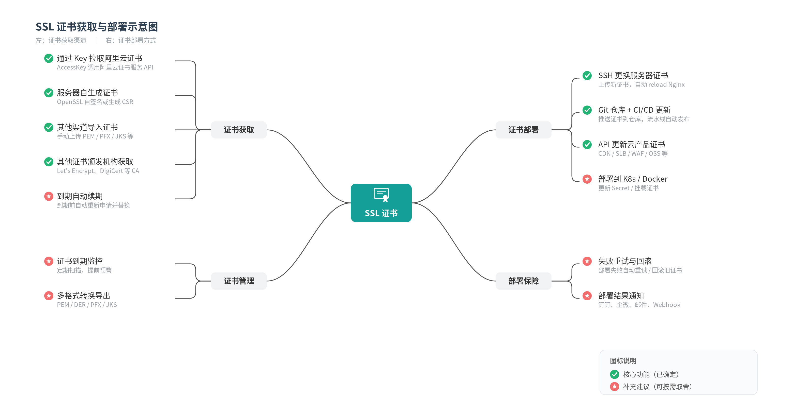
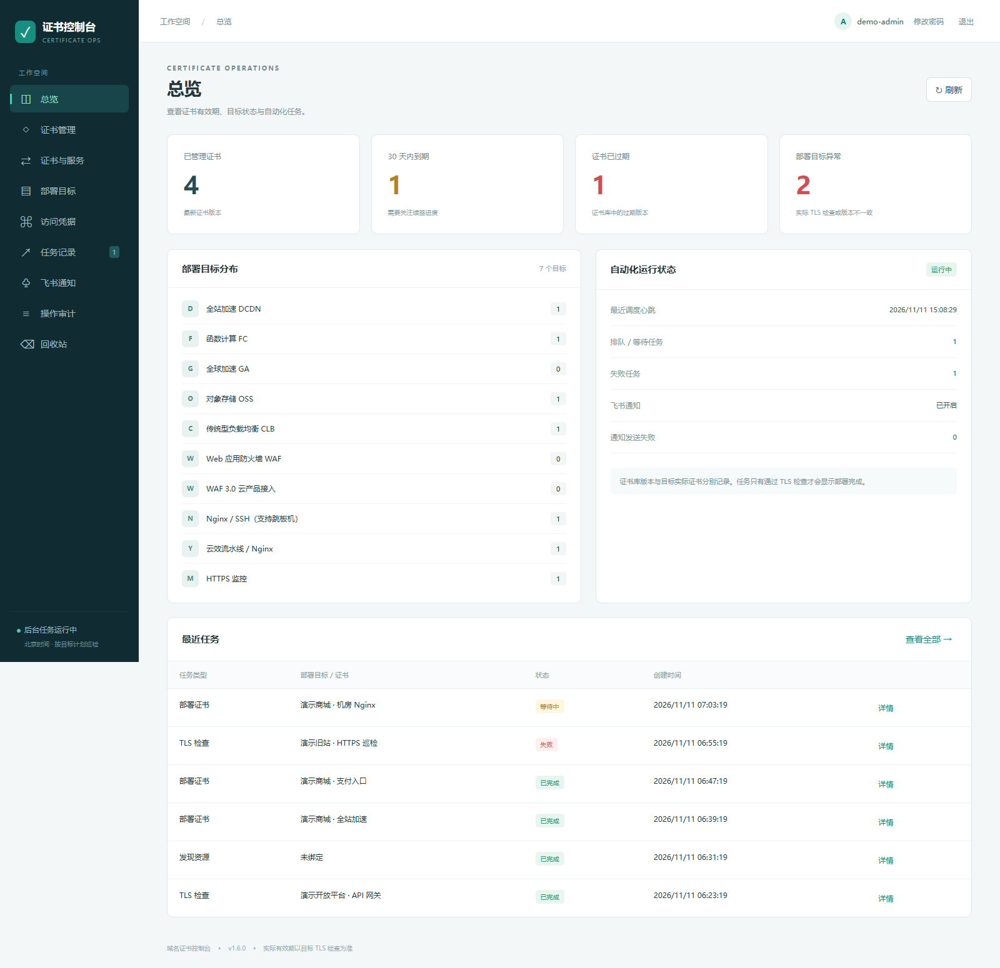
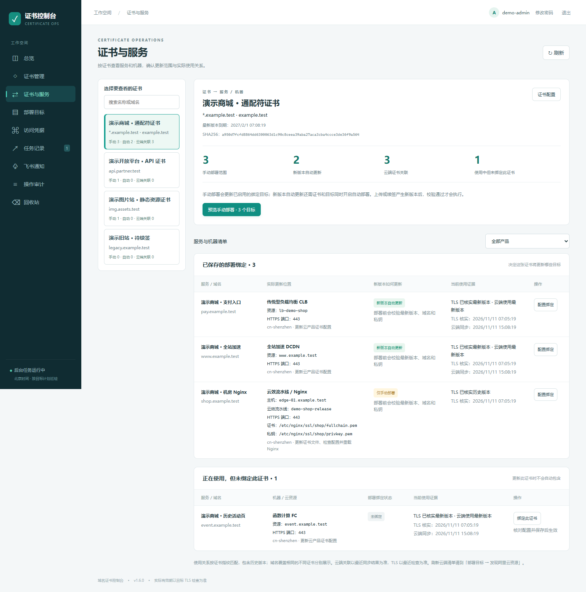
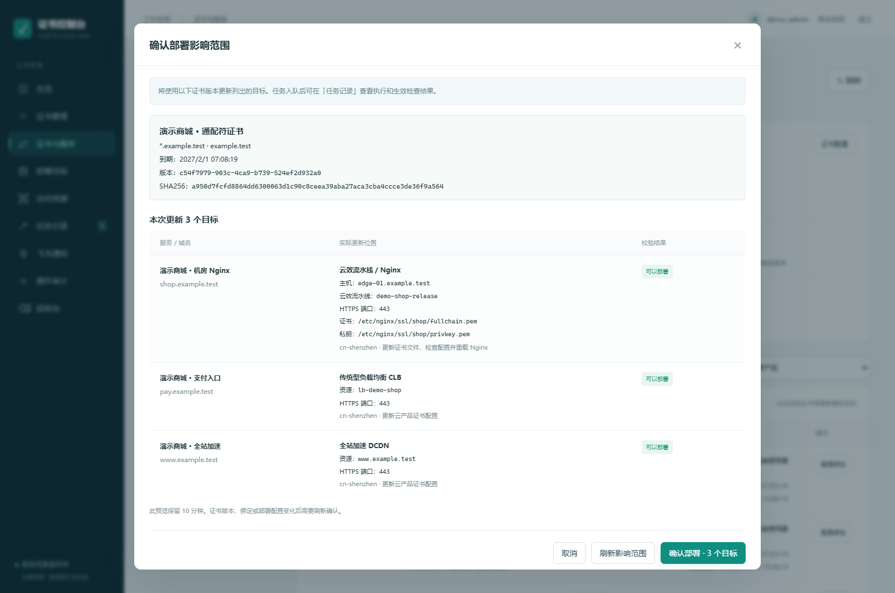
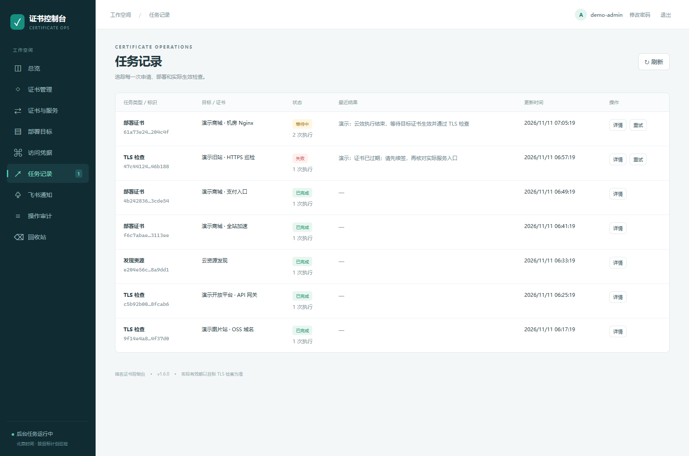

# CertOps · 证书部署与运维控制台

[English](README.en.md) · [国内镜像 Gitee](https://gitee.com/norman-tan/certops) · [首次试用](docs/TRY_IT.md) · [常见问题](docs/FAQ.md) · [项目简介与分享文案](docs/PROJECT_BRIEF.md)

[](https://github.com/tanxl0810-cyber/certops/actions/workflows/ci.yml)

**从证书到期提醒，到每个入口的换证与生效检查。**

官网走 DCDN，支付入口在负载均衡上，机房里还跑着几台 Nginx。同一张通配符证书，换一次就要找资源、传文件、重载服务，再逐个打开域名确认有没有生效。入口一多，很容易漏掉一处，或把证书库里的新版本当成线上已经用上的版本。

CertOps 把这条换证流程放进一个可以自己部署的控制台：保存证书版本，找到使用它的服务，预览本次更新范围，再跟踪任务和实际 TLS 结果。适合同时维护阿里云资源、自建主机和机房服务的运维团队。

软件采用 [Apache-2.0](LICENSE) 许可证，可免费获取、自行部署并商业使用。需要协助接入现有环境时，也可以购买[部署、定制与维护服务](SERVICES.md)。

[看页面与场景](#跟着一次换证看系统) · [快速开始](#快速开始) · [部署文档](docs/DEPLOYMENT.md) · [付费服务](SERVICES.md)

## 系统示意图

从证书获取、集中管理，到部署更新与结果检查，可以先用这张图了解整体流程。



这张图包含流程设计与可选扩展，绿色勾选和红星沿用原图分类。当前版本支持 PEM 上传、阿里云证书导入与已有资源申请、云产品 / SSH / 云效部署、TLS 核对和飞书通知；通用 ACME、PFX/JKS 转换、K8S Secret 自动更新及其他通知渠道尚未内置。完整说明见[图示与当前功能对照](docs/SYSTEM_OVERVIEW.md)。

## 跟着一次换证看系统

下面四张图来自实际运行的界面，使用独立演示数据库。域名、机器名、资源编号、证书及任务状态均为虚构演示数据，没有使用生产资料。点击图片可查看原图；[截图说明](docs/images/README.md)记录了展示范围。

### 1. 日常巡检：先找到快到期和状态异常的入口

打开总览，先看 30 天内到期的证书、已经过期的证书，以及实际 TLS 检查或版本不一致的目标，再查看最近任务。

例如图中的演示环境有 4 张证书、7 个目标：一张快到期，一张已经过期，两个入口需要关注。证书库里的版本和目标实际使用的版本分别记录，换证后仍用着历史版本的入口也能被看出来。可选的飞书通知用于把临期、异常和恢复情况发到运维群。



### 2. 换证之前：理清一张证书用到了哪些服务

一张 `*.example.test` 同时供商城加速、支付入口和机房 Nginx 使用。进入「证书与服务」，可以沿着证书看到具体服务、机器、云资源、证书文件位置，以及当前使用的是最新版本还是历史版本。

图中保存了 3 个部署绑定，其中 2 个会随新版本自动更新，机房 Nginx 保留为手动部署。下方还有一个正在使用此证书的历史活动页，尚未保存部署绑定，因此不会自动跟随证书更新。接手旧项目、盘点证书去向或准备变更时，可以先把这些关系核对清楚。



### 3. 发布窗口：确认这次具体会改哪些位置

准备部署时，先查看影响预览：使用哪个证书版本、覆盖哪些域名、更新几个目标，以及每个目标对应的监听端口、机器、流水线和文件路径。

图中的这次预览列出 3 个目标：DCDN、CLB 和机房 Nginx。系统会校验证书、私钥和域名覆盖范围；证书版本、绑定或部署配置发生变化后，需要刷新预览再确认。可以先验证测试目标，再按自己的变更窗口操作生产入口。



### 4. 操作之后：跟踪任务，确认入口实际换上了证书

部署任务会继续检查目标的 TLS 证书。入口还没生效时保留等待状态；检查失败时可以查看原因，核对配置后再处理。

图中同时展示了已完成的云产品部署、等待 TLS 生效的机房任务，以及证书过期导致的巡检失败。云 API 提交结果不明时，系统先核对实际证书，并暂停该目标后续自动部署，处理步骤见[运维文档](docs/OPERATIONS.md)。需要回退时，也可以先预览历史版本的影响范围。



## 可以接入哪些环境

| 手头的环境或需求 | 对应能力 |
| --- | --- |
| 已有证书、历史版本比较多 | 上传或阿里云导入，校验证书与私钥，按指纹去重，保留历史版本 |
| 阿里云入口分散在多个产品里 | 发现 DCDN、FC、GA、OSS、CLB、WAF 资源，核对证书关联和部署绑定 |
| 已有阿里云证书申请额度或订阅实例 | 使用 SSL V1.0 资源包或 V2.0 订阅实例申请、验证并轮询签发 |
| 云上和自建主机一起维护 | 云产品 API、SSH/SFTP、支持跳板机的 Nginx 部署、云效流水线接入 |
| 机房主机需要通过现有流水线更新 | 云效主机接入、证书文件切换、Nginx 配置检查、重载与失败恢复 |
| 需要核对实际入口 | SNI、指定探测地址、非标准端口、自定义 CA 与实际证书指纹检查 |
| 团队需要提醒和操作记录 | 可选飞书通知、飞书成员白名单登录、操作审计与可恢复的回收站 |

证书私钥和访问凭据在数据库中加密保存。当前适用范围和限制见下方[当前边界](#当前边界)。

## 快速开始

推荐 Linux x86_64、Docker Engine 与 Docker Compose v2；初始化脚本需要 Python 3.10+ 标准库。建议为整套服务预留至少 2 GB 内存，按资产规模调整。

前端 Vue 3，后端 FastAPI，任务和证书数据保存在独立 PostgreSQL 中。默认部署不依赖其他业务系统，不需要 Redis。

下载源码并启动：

```bash
git clone https://github.com/tanxl0810-cyber/certops.git
cd certops
python3 ops/init.py
docker compose up -d --build --wait
docker compose ps
```

访问 <http://127.0.0.1:18090>。账号为 `admin`；初始密码保存在本机 `.env` 的 `ADMIN_PASSWORD` 中，请在本机查看，首次登录后必须修改。初始化脚本不会打印密码，重复执行也不会覆盖原有 `.env`。

如果部署在远程服务器，可以先通过自己的 SSH 连接建立隧道：

```bash
ssh -L 18090:127.0.0.1:18090 your-user@your-server
```

默认仅监听回环地址，数据库端口不对外发布。正式部署请按照[独立部署文档](docs/DEPLOYMENT.md)设置 HTTPS、公开域名和代理配置。

## 首次接入

1. 使用本地管理员登录并修改初始密码。
2. 在“访问凭据”添加专用云账号或主机凭据；阿里云权限参考 [RAM 接入说明](docs/ALIYUN.md)。
3. 上传证书，或从阿里云选择证书导入。
4. 创建或发现部署目标，核对域名、端口、证书绑定和具体证书槽位。
5. 先在测试目标上验证部署、实际 TLS 结果和回退，再按需要开启自动续签与自动部署。

自动续签和自动部署分别控制。阿里云的证书购买、订阅续费和申请额度由用户自行管理，软件不会自动购买证书。

## 文档

| 内容 | 文档 |
| --- | --- |
| 独立部署、配置与升级 | [DEPLOYMENT](docs/DEPLOYMENT.md) |
| 备份与恢复 | [OPERATIONS](docs/OPERATIONS.md) |
| 阿里云权限与接入 | [ALIYUN](docs/ALIYUN.md) |
| 云效部署机房 Nginx | [YUNXIAO](docs/YUNXIAO.md) |
| 可选飞书登录 | [FEISHU](docs/FEISHU.md) |
| 本地开发与验证 | [DEVELOPMENT](docs/DEVELOPMENT.md) |
| 付费服务与交付范围 | [SERVICES](SERVICES.md) |
| 漏洞反馈 | [SECURITY](SECURITY.md) |
| 贡献约定 | [CONTRIBUTING](CONTRIBUTING.md) |
| 本次公开版本整理范围 | [RELEASE](docs/RELEASE.md) |
| 第一次安装和试用 | [TRY_IT](docs/TRY_IT.md) |
| 能力、费用与使用边界 | [FAQ](docs/FAQ.md) |
| 项目事实摘要与分享文案 | [PROJECT_BRIEF](docs/PROJECT_BRIEF.md) |

## 当前边界

这是早期公开版本。当前没有通用 ACME / Let's Encrypt 自动申请适配器；可使用上传证书、阿里云导入及已有阿里云申请资源。

当前登录用户均拥有系统管理权限，尚无租户隔离或细粒度 RBAC。适合由可信运维团队管理；飞书成员须显式加入白名单。后台任务采用单 worker 进程，不支持通过增加 worker 副本实现高可用。

浏览器中的手动部署与上传会确认影响预览；为兼容已有调用方，部分 API 仍允许省略预览令牌，但认证和资源边界校验继续生效。直接使用 API 的运维人员应自行核对具体版本和目标范围。

云部署提交结果不明时停止自动重发，并先核对实际证书；确认云端未生效后，才创建新的部署任务。处理步骤见 [OPERATIONS](docs/OPERATIONS.md)。

自动化测试与测试替身验证不能代替各云账号、产品版本及业务环境的真实验收。接入具体环境后，需要完成权限核对、测试换证与回退演练。共享监听器尤其需要核对证书覆盖范围。

## 许可证与联系

项目原创代码采用 [Apache License 2.0](LICENSE)。第三方组件仍遵循其各自许可证，见 [THIRD_PARTY_NOTICES](THIRD_PARTY_NOTICES.md)。软件按现状提供，具体条款以许可证为准。

业务咨询：<tanxl0810@gmail.com>。付费服务为可选项，不影响许可证赋予的软件使用权。

微信联系：扫描下方名片添加维护者，备注「CertOps / 部署咨询」。名片昵称为 **mmt-m**。


如果你已经有云账号、机房和发布流水线，希望有人协助把它们接起来，可以说明环境、目标数量和期望流程。独立部署、现有系统对接、产品适配和后续维护的范围见 [SERVICES](SERVICES.md)；首次联系请提供脱敏描述。
