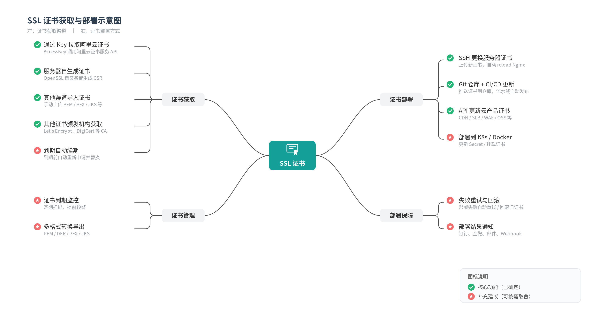

# 系统示意图与当前功能

下面的原图由维护者提供，用于说明证书获取、管理、部署与保障的整体思路，保留原始内容。图中的绿勾和红星表示原图的设计分类，具体可用能力以当前代码和部署文档为准。

## 当前版本可以完成的流程

导入或申请证书 → 保存并校验证书版本 → 核对证书与服务关系 → 预览部署影响 → 执行更新 → 检查实际 TLS 证书 → 查看任务与通知。

| 图中环节 | 当前实现与使用方式 |
| --- | --- |
| 通过 Key 拉取阿里云证书 | 使用专用限权 AccessKey 接入，导入阿里云已有 SSL 证书；云端可提供私钥时加密保存 |
| 服务器生成或其他渠道获取证书 | 可将外部工具或其他 CA 提供的 PEM 证书与私钥上传；控制台没有通用自签证书 / CSR 生成界面 |
| 自动申请与续签 | 接入阿里云 SSL V1.0 资源包或 V2.0 订阅实例；需要已有额度或实例并显式开启相应自动化 |
| 证书管理与到期监控 | 历史版本、指纹去重、加密保存、到期统计、目标实际 TLS 检查与操作审计 |
| SSH 更换服务器证书 | 支持 SSH/SFTP 与跳板机、Nginx 配置检查、文件切换、重载及失败恢复 |
| CI/CD 更新 | 当前集成云效流水线，部署机通过受限任务令牌按需获取对应证书；部署脚本可纳入现有代码管理流程 |
| API 更新云产品证书 | DCDN、FC、GA、OSS、CLB、WAF 等已适配目标；具体权限、证书槽位和账号兼容性按接入文档核对 |
| 重试与回退 | 保留任务进度、检查实际生效结果，支持历史版本回退；云提交结果不明时先核对，不盲目重复写入 |
| 部署结果通知 | 当前内置飞书临期、异常和恢复通知 |

## 图中的扩展范围

- 通用 ACME / Let's Encrypt 自动申请与续签尚未内置。
- 上传入口以 PEM 证书和私钥为主，尚无通用 DER / PFX / JKS 导入、转换或导出工具。
- Docker Compose 用于部署 CertOps 自身；自动更新目标 K8S Secret 或容器挂载证书的适配器尚未提供。
- 钉钉、企业微信、邮件及通用 Webhook 通知适配尚未提供。
- 通用「把证书写入任意 Git 仓库后自动分发」尚未提供。当前云效流程通过受限接口获取证书，证书私钥与访问凭据应保存在受保护的存储中，不能提交到公开 Git 仓库。

这些扩展可作为需求讨论的起点，交付范围需单独确认。部署和操作步骤见 [DEPLOYMENT](DEPLOYMENT.md)、[OPERATIONS](OPERATIONS.md) 与 [YUNXIAO](YUNXIAO.md)，定制联系见 [SERVICES](../SERVICES.md)。
